# JunkSnap

**Snap the junk. Prove it. Get it cleared.** Residents photograph waste; JunkSnap blurs it, checks it with stacked models, maps it to the ward, MLA and MP, and drafts a cited letter for the resident to file.

[](https://youtu.be/cdspylgoFm4)
[](https://junksnap.coehemang.dev)
[](https://github.com/Girish-Garg/JunkSnap/releases/latest)
[](LICENSE)
[](#aws-services-and-why)

<table>
  <tr>
    <td rowspan="2" valign="top">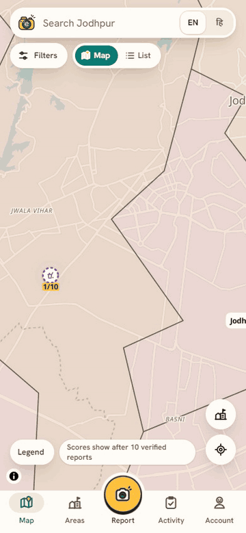</td>
    <td align="center" valign="top">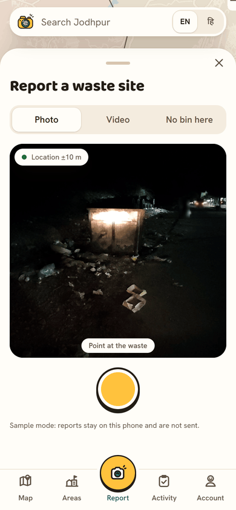<br><sub>1. Snap in the app camera<br><i>sample data</i></sub></td>
    <td align="center" valign="top">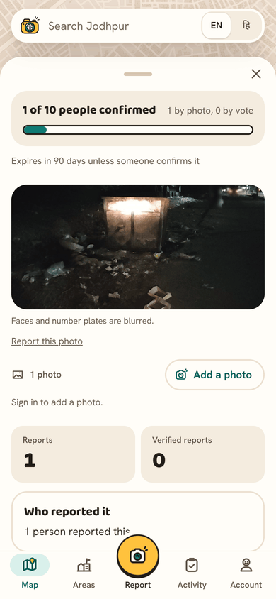<br><sub>2. Blurred photo,<br>1 of 10 backers</sub></td>
    <td align="center" valign="top">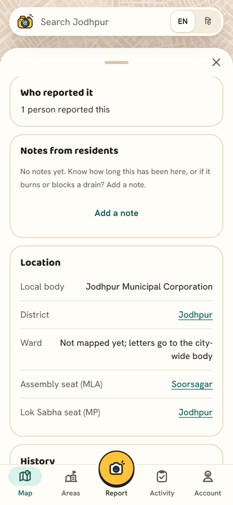<br><sub>3. Ward, MLA and<br>MP seats</sub></td>
  </tr>
  <tr>
    <td align="center" valign="top">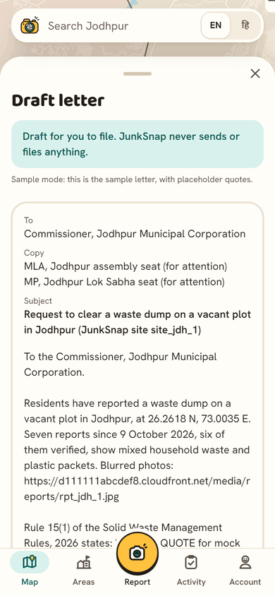<br><sub>4. Cited letter to file<br><i>sample data</i></sub></td>
    <td align="center" valign="top">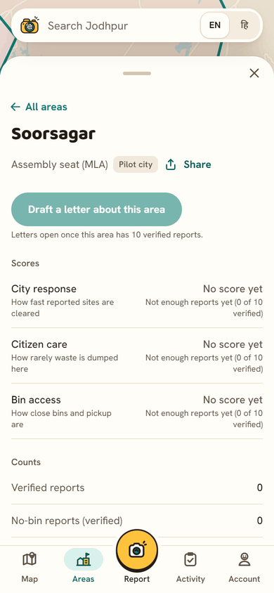<br><sub>5. Area report,<br>scores after 10</sub></td>
    <td align="center" valign="top">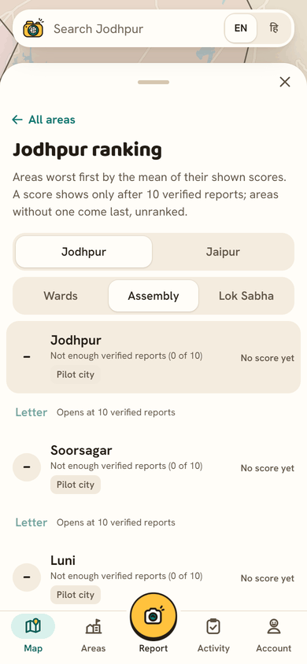<br><sub>6. City ranking<br>of seats</sub></td>
  </tr>
</table>

Built on AWS, in `ap-south-1` (full diagram under [Architecture](#architecture)):

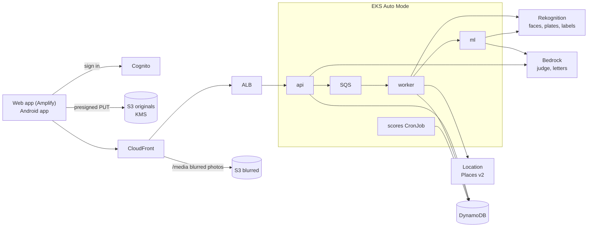

Dumps are not only the authorities' failure. People dump on empty plots, often because there is nowhere legal to put waste. JunkSnap measures all three causes: how fast the city clears dumps, how much residents dump, and whether people have anywhere legal to put waste.

Anyone in India can photograph waste with the in-app camera. JunkSnap blurs faces and number plates, checks the photo with several models stacked together, puts it on the map as a site, and marks the site verified once 10 different people back it. It finds the site's ward, assembly seat (MLA) and Lok Sabha seat (MP), scores each area, and drafts cited letters to the bodies that must act. Every rule quoted in a letter is checked word for word against the official text. Jodhpur, Rajasthan is the pilot city, where the data goes deepest.

Built for Environmental Hacks (Bharat Builds Tour by WeMakeDevs and AWS), 8 to 11 October 2026, Waste and Energy track.

- Demo video (under 3 minutes): https://youtu.be/cdspylgoFm4
- Web app: https://junksnap.coehemang.dev (on AWS Amplify Hosting)
- API (through CloudFront): https://d2s7tf4ua41hzf.cloudfront.net/healthz
- Android app: the APK is a release-signed GitHub Release built by the `android-release` workflow; get the latest at https://github.com/Girish-Garg/JunkSnap/releases/latest. Share links (`https://junksnap.coehemang.dev/share/...`) and site and area links open the installed app (verified App Links), else the browser. App Links cover both web hosts, `junksnap.coehemang.dev` and the original Amplify address `demo.d3iec0rb3f75jm.amplifyapp.com`, and the API's `/share/` links; see [docs/android.md](docs/android.md).

## Screens

<table>
  <tr>
    <td align="center" valign="top">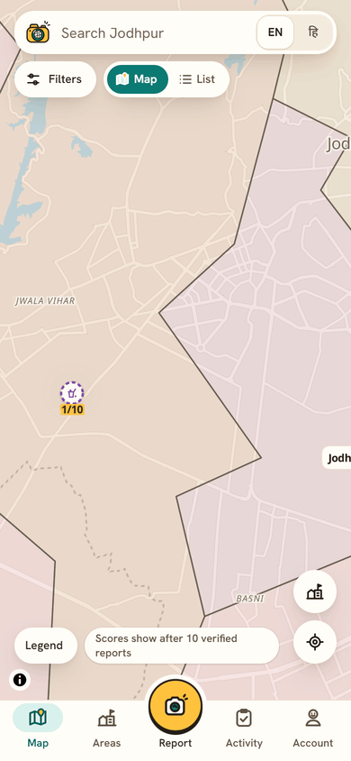<br><sub>Map opens on Jodhpur</sub></td>
    <td align="center" valign="top">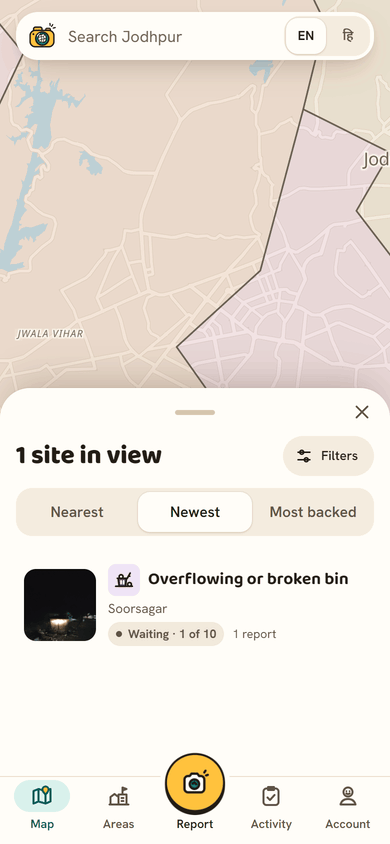<br><sub>List of sites in view</sub></td>
    <td align="center" valign="top">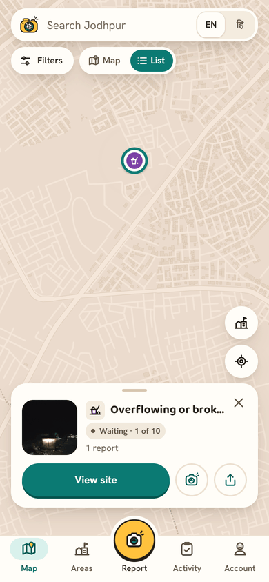<br><sub>Pin card</sub></td>
    <td align="center" valign="top">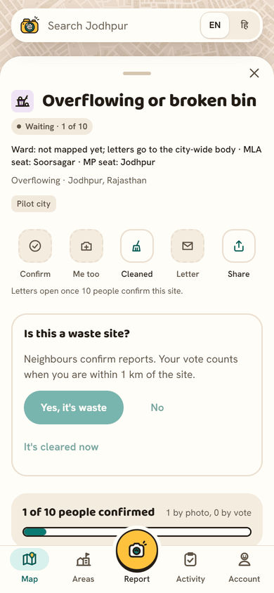<br><sub>Site: status and seats</sub></td>
  </tr>
  <tr>
    <td align="center" valign="top">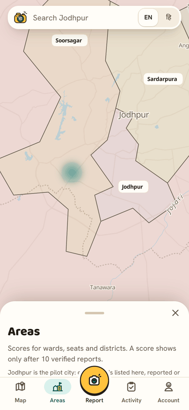<br><sub>Areas map</sub></td>
    <td align="center" valign="top">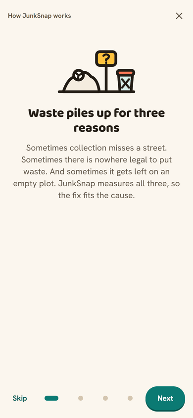<br><sub>How JunkSnap works</sub></td>
    <td align="center" valign="top">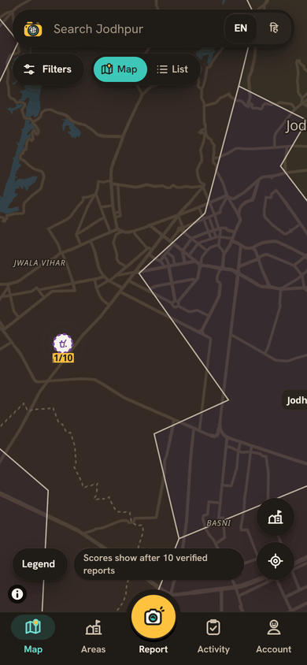<br><sub>Dark mode</sub></td>
    <td align="center" valign="top">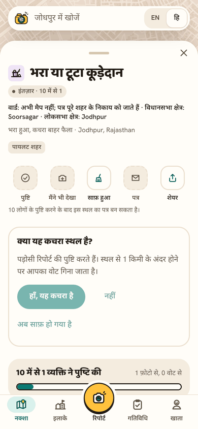<br><sub>Hindi</sub></td>
  </tr>
  <tr>
    <td align="center" valign="top">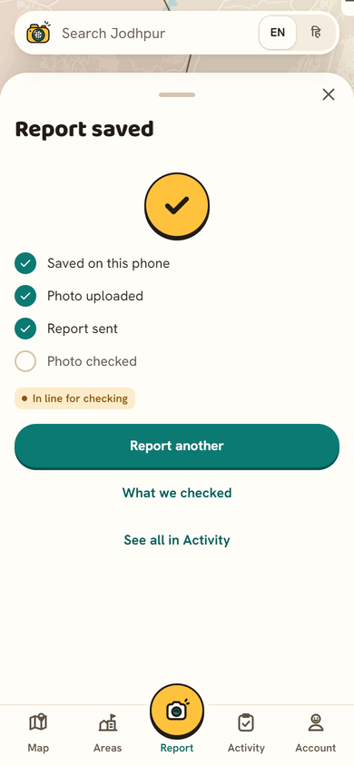<br><sub>Report saved<br><i>sample data</i></sub></td>
    <td align="center" valign="top">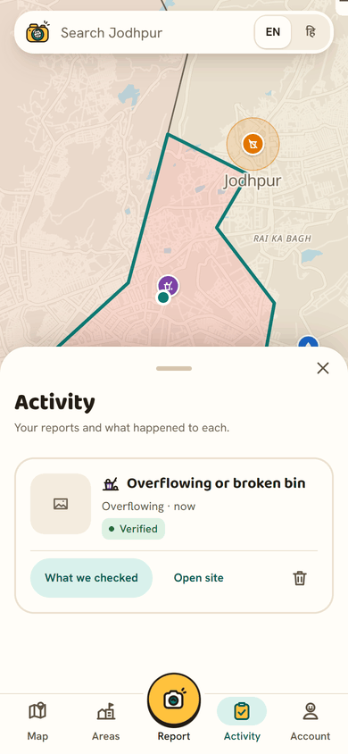<br><sub>Activity<br><i>sample data</i></sub></td>
    <td align="center" valign="top">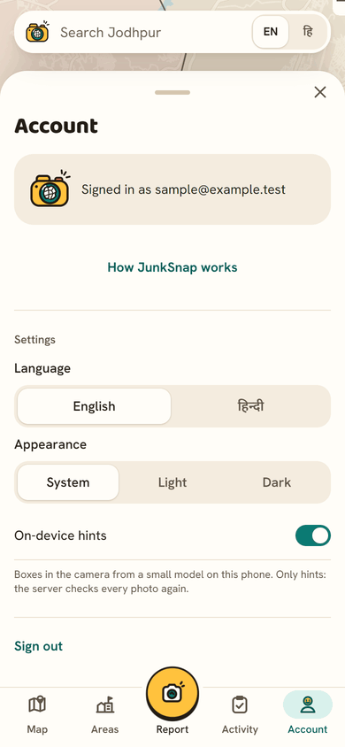<br><sub>Account and settings<br><i>sample data</i></sub></td>
    <td></td>
  </tr>
</table>

<sub>Every image without a label is the live web app, signed out, captured before the field run, when the map had one site. Images marked <i>sample data</i> show signed-in screens from the web app's mock mode (`VITE_API_MODE=mock`, fixtures in `contracts/fixtures/`); the camera feed in the Snap screen is a blurred public photo from the live app.</sub>

## How a report flows

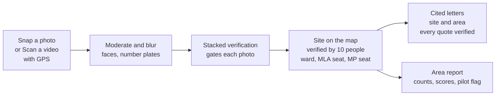

1. **Snap or Scan.** A signed-in user takes a photo in the app, or records a video of up to 60 s with a GPS track recorded alongside it. Report types: waste dump, no bin or pickup, overflowing or broken bin, contaminated water and open construction. On phones that pass a speed probe, a small YOLO detector runs in the browser and draws live boxes in Snap and Scan; it also sends frame hints for a Scan. Phones that fail the probe or its 150 ms warm-up stay in cloud mode, and the server always re-verifies. The phone hashes the photo, uploads it straight to a private S3 bucket with a presigned URL, and posts the report. An offline queue retries when there is no network. For a Scan, the server cuts one frame per second, places each frame on the GPS track, drops frames without a close and accurate fix, and runs each kept frame as a normal report.
2. **Moderate and blur.** The worker rejects unsafe images, blurs faces and number plates, and only then writes a public copy. It also checks that the photo is inside India, has a fresh timestamp, is not a near-duplicate, and that the device and user are under their rate limits. The optional note is checked for abuse and personal data on Bedrock.
3. **Stacked verification.** The `ml` service scores the blurred copy with three signals: Rekognition labels, our YOLO26 detector and a SigLIP 2 embedding classifier. A vision model judges every photo too (Amazon Nova Lite on Bedrock, then Nova Pro, then an OpenAI model if both fail), answering yes, no or uncertain for each thing the claim needs, such as garbage, a bin, an overflowing bin or a usable photo. For waste-dump and no-bin reports, a logistic-regression meta-learner turns the signals and the judge's answer into one probability; the other types use fixed weights led by the judge. The models gate each photo: a photo they reject (probability under 0.5, or a clear no from the judge) stops here, unless the trained detector is sure (YOLO 0.5 or more), which sends it to a community check instead; when the judge is unsure, the app asks the reporter to keep the report only if they are 100% sure; any other photo joins a site. The result also lists what the waste is (materials, size class, burning and other hazards). Every decision records the provider, model and version that made it.
4. **Site, verified by 10 people.** A site appears on the map from its first photo the models pass, shown as "1 of 10". Reports of the same type within 20 m always merge into it, and from 20 m up to 40 m only when the photos match (cosine 0.88 or more). Reports at one spot take turns choosing a site, so phones that send together never found two sites there. Duplicates made before these rules were folded once into the oldest site (`backend/server/scripts/mergeSameSpotSites.ts`), and old links to them open the site they joined. A site is verified when 10 different people back it, with a passed photo of it or a yes vote; a model never verifies a site alone. When people voting no outnumber the backers by 3 or more, the site leaves the map. At start, after the first-run cards, the app reads a fix quietly when location is already allowed, and otherwise asks for it, at most once per launch. After one refusal it never asks at start again until location is allowed. Actions that check your distance from the site (vote, Me too, Cleaned, Add a photo, Report a photo) ask again when tapped if it is still not allowed; if it is blocked, they say how to allow it ("Open app settings" in the Android app, the browser's steps on the web). Every blurred photo of a site shows in a swipeable strip and opens in a full-screen viewer. Residents can add notes to a site, and Bedrock summarises them.
5. **No bin within 1 km.** A missing dustbin cannot be photographed, so a signed-in user reports "There is no dustbin within 1 km of here" from where they stand, photo optional. Reports within 500 m join one community zone, drawn as a 1 km circle and verified when 10 people back it. The nearest mapped bin is shown as evidence and never blocks verification.
6. **Location: ward, MLA and MP.** Amazon Location reverse geocoding gives state, district and town; point-in-polygon lookups give the assembly seat (Rajasthan) and the Lok Sabha seat; the local body comes from our own table. Ward is filled only where an open ward map exists. Schools, hospitals, water bodies and open drains within 100 m come from OpenStreetMap. When a district gets its first verified report, the ward crawler is queued to collect official ward data for it, and the app shows a banner while it runs.
7. **Cited letters.** For any open site, verified or not, or for one issue across a ward, seat or district, the api picks the addressees and the rule clauses from hashed official texts, such as the Solid Waste Management Rules, 2026 (S.O. 388(E), 27 January 2026, in force 1 April 2026). Site and ward or assembly letters go To the local body head; Lok Sabha and district letters go to the District Collector first. The councillor, MLA and MP are copied "for attention" only where those seats are known. A model on Bedrock writes the prose, and a verifier checks every quote word for word; if a quote fails, a template letter with the same verified citations is used. Every letter carries evidence: report counts, distinct reporters, dates, blurred photos and measured insights, plus a line on what residents noted. A site letter states how many residents back the site so far ("community verification in progress (N of 10 people confirmed so far)") and calls it verified only once 10 have; if the model's prose calls an unverified site verified, the template letter is used instead. An area letter still needs 10 verified reports for its issue in the area. Letters print to PDF or share; nothing is filed automatically, the resident files it.
8. **Area report.** Every 15 minutes a CronJob computes city, citizen and bin-access scores per ward, assembly seat, Lok Sabha seat and district, with a diagnosis (infrastructure gap, behaviour, city response, repeat spot) and area insights. The city score counts how often overflowing or broken bins are serviced once an area has 3 verified ones. A score shows only after 10 verified reports in the area. Counts always show, pilot areas are flagged, and no history is invented. The Areas map shows assembly seats in Rajasthan and Lok Sabha seats elsewhere in one layer, with a marker inside each area for its score or verified report count, and a ranking that lists a city's areas worst first.

## Architecture

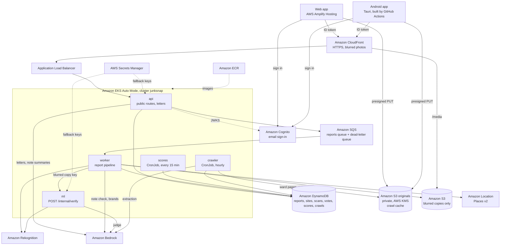

- One TypeScript project, `backend/server` (Node 24), builds one image that runs three workloads: `api` (every public route), `worker` (the report pipeline, reading SQS) and `scores` (the CronJob).
- One Python service, `backend/ml` (FastAPI), runs verification. It has no public route; only the worker calls it inside the cluster, and it only ever sees the blurred copy.
- The ward crawler (`data/ward_crawler`) runs as an hourly CronJob from its own image. It crawls districts that became active, re-crawls every 30 days, caches every page and extraction in S3, and never replaces good ward data with a failed or emptier crawl.
- The web app (React and MapLibre) has light, dark and system themes, onboarding cards and a desktop layout with a side panel. The Android app (`apps/android-tauri`) is a Tauri 2 shell around the same build, with camera and location permissions, native share and print to PDF.
- Every pipeline step is idempotent per report, so SQS retries cannot double-count. After three failed attempts the worker marks the report `needs_review` and the message moves to the dead-letter queue, so no report waits forever.
- `contracts/` holds the JSON schemas, fixtures, routes, tables and S3 layout that every part shares. More detail: [docs/architecture.md](docs/architecture.md).

## AWS services and why

| Service | What it does in JunkSnap | Where |
|---|---|---|
| Amazon EKS (Auto Mode) | Runs `api`, `worker`, `ml`, the `scores` CronJob and the `crawler` CronJob in one cluster, one namespace per stage | `infra/eks/cluster.yaml`, `infra/k8s/` |
| Amazon ECR | Holds the `junksnap-server`, `junksnap-ml` and `junksnap-crawler` images | `infra/aws/shared.yaml` |
| Amazon CloudFront + Application Load Balancer | HTTPS for the API, and serves blurred photos under `/media/*`; the ALB accepts traffic only from CloudFront | `infra/aws/stage.yaml`, `infra/k8s/base/ingress.yaml` |
| Amazon S3 + AWS KMS | Originals, scan videos and the crawler's page cache in a private bucket encrypted with KMS; a separate bucket holds only blurred copies | `infra/aws/stage.yaml` |
| Amazon SQS | Reports queue with a dead-letter queue, so slow model calls never block the phone | `backend/server/src/adapters/SqsQueuePoller.ts` |
| Amazon DynamoDB | On-demand tables for reports, cleanups, scans, sites, votes, devices, users, scores, crawls and residents' notes | `backend/server/src/adapters/Dynamo*.ts` |
| Amazon Cognito | Email sign-in; the api checks the ID token against the pool's keys. No name or email is stored outside Cognito | `backend/server/src/adapters/CognitoAuthenticator.ts` |
| Amazon Rekognition | Unsafe-image check, face boxes and number plates for blurring, labels as a verification signal, and readable text for brand labels | `backend/server/src/adapters/moderation/`, `backend/ml/src/ml/adapters/rekognition_labels.py` |
| Amazon Bedrock | Vision judge for every photo (Nova Lite first), letter prose, summaries of residents' notes, brand reading, note moderation and ward-data extraction. Bedrock is the default for anything personal | `backend/ml/src/ml/adapters/bedrock_converse.py`, `backend/server/src/adapters/llm/` |
| Amazon Location Service (Places v2) | Reverse geocoding to state, district and town; no place index needed | `backend/server/src/adapters/location/GeoPlacesReverseGeocoder.ts` |
| AWS Amplify Hosting | Hosts the web app | `scripts/deploy_web.py`, `amplify.yml` |
| AWS CloudFormation, EKS Pod Identity, Secrets Manager | Per-stage stacks `junksnap-<stage>`; one least-privilege role per workload, no keys in pods; fallback provider keys | `infra/aws/stage.yaml` |

Everything runs in `ap-south-1` (Mumbai) and is tagged `project=junksnap`.

## Machine learning

Full method and every table: [docs/ml/eval.md](docs/ml/eval.md). Models are trained and evaluated on openly licensed public data only. All numbers are measured on the public test split of those datasets (QR4Change, TACO, garbage_od, D-Fire), hash split with seed 26, on 10 and 11 October 2026. No Jodhpur photo is trained on or evaluated, so real-world accuracy in Jodhpur is not measured here.

**Teacher-box caveat.** Every `waste_pile` and `bin` box was drawn by an OWLv2 model, not by people. For those two classes the detector numbers measure agreement with that teacher model, not with human labels.

**Detector.** YOLO26s, 80 epochs at 640 px, on 1,521 test photos:

| class | test boxes | who drew them | precision | recall | mAP50 |
|---|---|---|---|---|---|
| waste_item | 8,251 | people | 0.788 | 0.603 | 0.685 |
| burning | 212 | people | 0.582 | 0.571 | 0.559 |
| waste_pile | 116 | OWLv2 teacher | 0.575 | 0.466 | 0.482 |
| bin | 129 | OWLv2 teacher | 0.860 | 0.690 | 0.732 |
| all | 8,713 | | 0.761 | 0.466 | 0.537 |

`all` also counts 5 `bag` boxes (recall 0.000), too few to report.

**Phone detector.** A separate YOLO26n, trained 40 epochs at 320 px on the same data, is exported to ONNX (2.8 MB int8, 4.9 MB fp16). Test mAP50 at 320 px: 0.424 in PyTorch, 0.372 for the int8 file. The app loads the int8 file in a WASM worker for live boxes; its boxes are hints only.

**Embedding classifier.** Logistic heads on SigLIP 2 image embeddings, run locally as ONNX. On one fixed sample SigLIP 2 tied Bedrock's Titan Multimodal Embeddings (mean test F1 0.923 against 0.919), so SigLIP 2 is used: no per-photo cost, no quota, and the photo stays in the cluster. The waste-or-not head scores F1 0.969 on the 184 QR4Change test photos.

**The stack.** Each signal alone and the meta-learner, on the 184 QR4Change test photos (65 with garbage), checked against people's labels:

| | precision | recall | F1 | calibration error (ECE) |
|---|---|---|---|---|
| Rekognition labels | 0.667 | 0.954 | 0.785 | 0.113 |
| YOLO | 0.933 | 0.646 | 0.764 | 0.150 |
| SigLIP 2 classifier | 0.984 | 0.954 | 0.969 | 0.018 |

| combiner | accuracy | Brier | ECE | judge called | auto-verified (right) | rejected (right) | community check |
|---|---|---|---|---|---|---|---|
| fixed weights | 0.978 | 0.047 | 0.115 | 34% | 32 (32) | 89 (86) | 63 |
| meta-learner | 0.978 | 0.020 | 0.019 | 27% | 43 (42) | 89 (86) | 52 |

The meta-learner has the same accuracy as fixed weights, but its probabilities are honest (ECE 0.019 against 0.115) and it calls the judge less often. These replays use the per-photo rule from before sites needed 10 people, with the judge called only when unsure; today the judge sees every photo, the models only gate each photo, and people verify sites.

**Judge.** On 224 test photos, Amazon Nova Lite was the most accurate and cheapest judge: 0.929 on the waste-dump claim and 0.825 on burning, 1.5 s median, about $0.17 per 1,000 photos. Nova Pro scored 0.908 and 0.650. Claude models on Bedrock were not run because Bedrock refuses them for this account until Anthropic's use-case form is submitted. This per-model comparison used the first judge prompt (`judge_v0`) and was not re-run after the prompt gained the overflowing-bin type; the pipeline-level re-test of the current judge is below.

**Structured judge.** Since 11 October the judge answers yes, no or uncertain for each attribute (prompt `judge_v1`). Re-run on the same 184 QR4Change test photos with the same detector signals, clean photos accepted (auto-verified or sent to people) fell from 59 of 119 to 7, and genuine waste rejected stayed at 3 of 65 (accuracy 0.946, precision 0.899, recall 0.954).

**Site merging.** A report of the same type within 20 m of a site always joins it. From 20 m up to 40 m it joins only when the two photos' SigLIP 2 vectors have cosine 0.88 or more. On simulated second shots this kept 95% of same-pile pairs and merged 15% of different piles, so two field photos of one dump less than 1 m apart could still split; the 20 m rule closes that.

## Privacy

- Faces and number plates are blurred before any public copy exists. Only the blurred copy is ever public. The blur never trusts "found nothing": a person or vehicle with no face or plate found is blurred where one would be, and dark photos get more blur, not less.
- Originals and scan videos stay in a private S3 bucket encrypted with KMS. Originals go only to Rekognition for moderation; every other model sees only the blurred copy. A scan video never goes to a model.
- The `ml` service cannot read the originals. Its role reads the blurred copies and the trained model files, and writes only embeddings.
- Personal text (the note) goes to Bedrock only.
- No photos of people dumping, and no individual is named in any text. Representatives are stored by office and seat, with no party field.
- Accounts live in Cognito. Tables and logs hold only an opaque user id. A lone no-bin reporter's pin is rounded to about 100 m.
- Company names appear only when a label is readable and above the confidence threshold.

## Run it locally

Tools: Node 24, [uv](https://docs.astral.sh/uv/), Python 3.12+, git.

```
# Web app. With no VITE_API_URL it runs in mock mode on contracts/fixtures.
cd frontend; npm ci; npm run dev; npm run lint; npm test -- --run; npm run build

# TypeScript server (api, worker, scores)
cd backend/server; npm ci; npm run lint; npm run typecheck; npm test; npm run build

# Python ml service
cd backend/ml; uv sync; uv run ruff check .; uv run mypy --strict src; uv run pytest -q

# Shared checks
uv run scripts/validate_contracts.py
uv run scripts/check_config.py
uv run scripts/check_limits.py
```

To point the web app at a live stage, copy `frontend/.env.example` to `frontend/.env.local` and set `VITE_API_URL`, `VITE_COGNITO_USER_POOL_ID` and `VITE_COGNITO_CLIENT_ID` (from the stage stack's outputs). Tests stub AWS and model calls. To build the Android app, see [docs/android.md](docs/android.md).

## Configuration

Every tuning number (rate limits, radii, thresholds, timeouts, map and UI timings) is a variable with a default in code. `config/defaults.env` lists them all; `config/<stage>.env` holds only what differs for that stage, for example `SNAP_PER_HOUR=100` on demo for field-audit days. Values are public and set at deploy time: server and ml values go into a Kubernetes ConfigMap, and `VITE_*` values are baked into the web and Android builds. There is no public config endpoint. `scripts/stage_config.py` checks the files before any deploy or build, and `uv run scripts/check_config.py` (CI) checks them against the documented code defaults. How to change a value: [docs/config.md](docs/config.md).

## Deploy a stage

Region `ap-south-1`, CLI profile `junksnap`. A person signs in with `aws login --profile junksnap` and creates the cluster once with `eksctl create cluster -f infra/eks/cluster.yaml`. Then:

```
uv run scripts/deploy.py dev --origins https://dev.<amplify-app-id>.amplifyapp.com,http://localhost:5173,https://tauri.localhost
uv run scripts/deploy_web.py dev
uv run scripts/smoke_report.py <cloudfront-url>
uv run scripts/smoke.py <url> [<url> ...]
```

`deploy.py` deploys the shared and stage CloudFormation stacks, builds and pushes the images tagged with the git short SHA, renders the Kustomize overlay, applies it and points CloudFront at the ALB. Render with `kubectl kustomize infra/k8s/overlays/dev` and read the output before every apply. The `demo` stage is deployed by a person from a clean `main` only.

## Repo layout

| Folder | Holds |
|---|---|
| `frontend/` | React + MapLibre web app: map with the Areas layer, Snap, Scan, site sheet, photo viewer, letters, area pages, Activity, onboarding, light and dark themes, Hindi and English |
| `apps/android-tauri/` | Tauri 2 Android shell around the web app; release workflow in `.github/workflows/android-release.yml` |
| `backend/server/` | TypeScript api, worker and scores: moderation, location, sites, votes, no-bin zones, brands, notes, letters, scores |
| `backend/ml/` | Python verification service; `training/` trains the detectors, heads and meta-learner |
| `data/` | Seat and ward boundaries, local bodies and representatives by office, rule texts, brand map, ward-data crawler and its output |
| `infra/` | CloudFormation, eksctl and Kustomize |
| `contracts/` | Schemas, fixtures and the README of routes, tables and S3 keys |
| `config/` | Every tuning number: `defaults.env` and one override file per stage |
| `scripts/` | Deploy, Android build, smoke tests, contract, config and size-limit checks |
| `docs/` | Architecture, decisions, model evaluation, Android and configuration |

## What is built

- Capture: Snap and Scan with sign-in and the offline queue; five report types, including overflowing or broken bins; the on-phone YOLO detector for live boxes and scan hints, with cloud fallback on slow phones.
- Pipeline: moderation and blur; stacked verification with the judge on every photo; sites on the map from the first passed photo, verified by 10 people, with same-type reports within 20 m always in one site; no-bin community zones; location with ward, MLA and MP seats; brand labels; community votes and cleanup claims with an after-photo; residents' notes on a site, summarised on Bedrock.
- Letters: site letters for any open site, verified or not, that say how many residents back it; area letters once an issue has 10 verified reports in the area; both with evidence and the quote verifier, in English or Hindi, printed to PDF or shared.
- Map: pins within 20 m stack into one pin with a count; on a slow network the map says it is still loading while the list, Areas and Report keep working, and a failed basemap offers Try again; the app asks for location at start until it is refused once (the map still opens on Jodhpur), and actions that check distance ask on tap; a Places pill lists where the reports are, with counts, and from an empty view anywhere a chip leads back to Jodhpur's reports.
- Areas: scores with counts, the pilot flag, diagnosis and insights; the combined Areas map with markers and dark badges; a city ranking.
- Ward data: the crawler runs as a service on EKS. Approximate ward boundaries for 34 of Jodhpur's 100 wards and 12 of Jaipur's 150 are built as unreviewed data files (`data/boundaries/*_wards.geojson`); they are not on the map and not used for lookups, scores or letters.
- App: the playful redesign with a cartoon logo, onboarding and dark mode; the Android app with a GitHub Actions APK release and App Links on both web hosts.
- Config: every tuning number is a variable in `config/`, checked before any deploy or build (see [Configuration](#configuration)).
- The deployed `ml` service loads the trained models at start (YOLO26s, the SigLIP 2 heads and the `meta-v2` meta-learner) and checks each file against its pinned SHA-256.
- Not built: drones and CCTV, potholes.

## Field run in Jodhpur

On 11 October 2026, 4 people filed 121 reports through the app in Jodhpur in about 2 hours 20 minutes. Of those, 114 passed the checks and 7 were rejected. After same-spot duplicates were merged, there are 44 open sites. All 44 are still unverified: a site needs 10 different people to back it. Wards are not filled in yet, because there is no reviewed map of Jodhpur's 2025 wards (see [data/boundaries/SOURCES.md](data/boundaries/SOURCES.md)). The field photos are not used to train or evaluate the models.

## Limits

- Photos show that waste exists, not who put it there. JunkSnap never names a person.
- No open ward map exists for Jodhpur, so letters and scores use the assembly and Lok Sabha seats there. Approximate ward boundaries for 34 of Jodhpur's 100 wards and 12 of Jaipur's 150 are built as unreviewed data files (`data/boundaries/*_wards.geojson`); they are not on the map and not used for lookups, scores or letters. Ward facts from the crawler stay marked unreviewed until a person checks them.
- Letters are drafts, not legal advice. The resident files them; nothing is sent automatically.

## Data sources

Training images: QR4Change (CC BY 4.0), TACO (CC BY 4.0), garbage_od (CC BY 4.0), D-Fire (CC0 1.0); see `data/datasets/SOURCES.md`. Seat boundaries: DataMeet and the Election Commission of India (CC BY 2.5 India, CC0 1.0); see `data/boundaries/SOURCES.md`. Map layers: OpenStreetMap contributors (ODbL 1.0). Rule texts: official Government of India gazette and CPCB PDFs, hashed; see `data/rules/SOURCES.md`. Ward records: Rajasthan government pages, fetched 10 October 2026; see `data/wards/README.md`.

## Docs

- [Architecture](docs/architecture.md)
- [Model evaluation](docs/ml/eval.md)
- [Android app](docs/android.md)
- [Configuration](docs/config.md)
- [Decisions](docs/decisions/)

## Team

Hemang, Girish, Harshit.

## AI tools used

Claude Code.

## Licence

AGPL-3.0 (see [LICENSE](LICENSE)). The detector is trained with Ultralytics YOLO (AGPL-3.0), so the server and phone models ship under the same licence (decision 20261010-0400).
