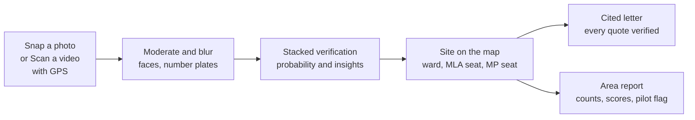
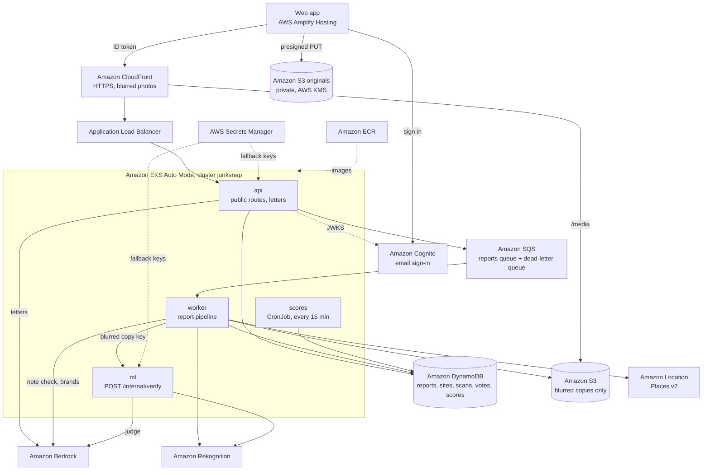

# JunkSnap

**Snap the junk. Prove it. Get it cleared.**

Dumps are not only the authorities' failure. People dump on empty plots, often because there is nowhere legal to put waste. JunkSnap measures all three causes: how fast the city clears dumps, how much residents dump, and whether people have anywhere legal to put waste.

Anyone in India can photograph waste with the in-app camera. JunkSnap blurs faces and number plates, checks the photo with several models stacked together, merges it into a site on the map, finds the site's ward, assembly seat (MLA) and Lok Sabha seat (MP), and drafts a letter to the body that must act. Every rule quoted in the letter is checked word for word against the official text. Jodhpur, Rajasthan is the pilot city, where the data goes deepest.

Built for Environmental Hacks (Bharat Builds Tour by WeMakeDevs and AWS), 8 to 11 October 2026, Waste and Energy track.

- Web app (dev stage): https://dev.d15q1nqls5cv8e.amplifyapp.com
- API (dev stage, through CloudFront): https://d39lwyuoeaze9r.cloudfront.net/healthz
- Short writeup: [docs/submission/writeup.md](docs/submission/writeup.md)

## How a report flows



1. **Snap or Scan.** A signed-in user takes a photo in the app, or records a video of up to 60 s with a GPS track recorded alongside it. The phone hashes the photo, uploads it straight to a private S3 bucket with a presigned URL, and posts the report. An offline queue in the browser retries when there is no network. For a Scan, the server cuts one frame per second, places each frame on the GPS track, drops frames without a close and accurate fix, and runs each kept frame as a normal report.
2. **Moderate and blur.** The worker rejects unsafe images, blurs faces and number plates, and only then writes a public copy. It also checks that the photo is inside India, has a fresh timestamp, is not a near-duplicate, and that the device and user are under their rate limits. The optional note is checked for abuse and personal data on Bedrock.
3. **Stacked verification.** The `ml` service scores the blurred copy with three signals: Rekognition labels, our YOLO26 detector and a SigLIP 2 embedding classifier. A logistic-regression meta-learner turns them into one probability. Only when the signals disagree or the probability is unsure does a vision model on Bedrock act as judge. A probability of 0.85 or more is auto-verified, 0.5 to 0.85 goes to neighbours for a community check, below 0.5 is rejected. When two signals differ by 0.5 or more, the report always goes to the community check. The result also lists what the waste is (materials, size class, burning and other hazards). Every decision records the provider, model and version that made it.
4. **Site with ward, MLA and MP.** Reports of the same type within 40 m that look alike merge into one site. Amazon Location reverse geocoding gives state, district and town; point-in-polygon lookups give the assembly seat (Rajasthan) and the Lok Sabha seat; the local body comes from our own table. Ward is filled only where an open ward map exists. Schools, hospitals, water bodies and open drains within 100 m come from OpenStreetMap.
5. **Cited letter.** For a verified site, the api picks the addressees (To the local body head, Cc the councillor, MLA and MP "for attention", only where those seats are known) and the rule clauses from hashed official texts, such as the Solid Waste Management Rules, 2026 (S.O. 388(E), 27 January 2026, in force 1 April 2026). A model on Bedrock writes the prose, and a verifier checks every quote word for word against the stored text. If a quote fails, a template letter with the same verified citations is used instead. Nothing is filed automatically; the resident files it.
6. **Area report.** Every 15 minutes a CronJob computes city, citizen and bin-access scores per ward, assembly seat, Lok Sabha seat and district, with a diagnosis (infrastructure gap, behaviour, city response, repeat spot) and area insights. A score shows only after 10 verified reports in the area. Counts always show, pilot areas are flagged, and no history is invented.

## Architecture



- One TypeScript project, `backend/server` (Node 24), builds one image that runs three workloads: `api` (every public route), `worker` (the report pipeline, reading SQS) and `scores` (the CronJob).
- One Python service, `backend/ml` (FastAPI), runs verification. It has no public route; only the worker calls it inside the cluster, and it only ever sees the blurred copy.
- Every pipeline step is idempotent per report, so SQS retries cannot double-count. After three failed attempts the worker marks the report `needs_review` and the message moves to the dead-letter queue, so no report waits forever.
- `contracts/` holds the JSON schemas, fixtures, routes, tables and S3 layout that every part shares. More detail: [docs/architecture.md](docs/architecture.md).

## AWS services and why

| Service | What it does in JunkSnap | Where |
|---|---|---|
| Amazon EKS (Auto Mode) | Runs `api`, `worker`, `ml` and the `scores` CronJob in one cluster, one namespace per stage | `infra/eks/cluster.yaml`, `infra/k8s/` |
| Amazon ECR | Holds the `junksnap-server` and `junksnap-ml` images | `infra/aws/shared.yaml` |
| Amazon CloudFront + Application Load Balancer | HTTPS for the API, and serves blurred photos under `/media/*`; the ALB accepts traffic only from CloudFront | `infra/aws/stage.yaml`, `infra/k8s/base/ingress.yaml` |
| Amazon S3 + AWS KMS | Originals and scan videos in a private bucket encrypted with KMS; a separate bucket holds only blurred copies | `infra/aws/stage.yaml` |
| Amazon SQS | Reports queue with a dead-letter queue, so slow model calls never block the phone | `backend/server/src/adapters/SqsQueuePoller.ts` |
| Amazon DynamoDB | On-demand tables for reports, cleanups, scans, sites, votes, devices, users and scores | `backend/server/src/adapters/Dynamo*.ts` |
| Amazon Cognito | Email sign-in; the api checks the ID token against the pool's keys. No name or email is stored outside Cognito | `backend/server/src/adapters/CognitoAuthenticator.ts` |
| Amazon Rekognition | Unsafe-image check, face boxes and number plates for blurring, labels as a verification signal, and readable text for brand labels | `backend/server/src/adapters/moderation/`, `backend/ml/src/ml/adapters/rekognition_labels.py` |
| Amazon Bedrock | Vision judge for unsure cases, letter prose, brand reading, note moderation and the ward-data crawler. Bedrock is the default for anything personal | `backend/ml/src/ml/adapters/bedrock_converse.py`, `backend/server/src/adapters/llm/` |
| Amazon Location Service (Places v2) | Reverse geocoding to state, district and town; no place index needed | `backend/server/src/adapters/location/GeoPlacesReverseGeocoder.ts` |
| AWS Amplify Hosting | Hosts the web app | `scripts/deploy_web.py`, `amplify.yml` |
| AWS CloudFormation, EKS Pod Identity, Secrets Manager | Per-stage stacks `junksnap-<stage>`; one least-privilege role per workload, no keys in pods; fallback provider keys | `infra/aws/stage.yaml` |

Everything runs in `ap-south-1` (Mumbai) and is tagged `project=junksnap`.

## Machine learning

Full method and every table: [docs/ml/eval.md](docs/ml/eval.md). All numbers are measured on the public test split of openly licensed datasets (QR4Change, TACO, garbage_od, D-Fire), hash split with seed 26, on 10 October 2026. No Jodhpur photo is trained on or evaluated, so real-world accuracy in Jodhpur is not measured here.

**Teacher-box caveat.** Every `waste_pile` and `bin` box was drawn by an OWLv2 model, not by people. For those two classes the detector numbers measure agreement with that teacher model, not with human labels.

**Detector.** YOLO26s, 80 epochs at 640 px, on 1,521 test photos:

| class | test boxes | who drew them | precision | recall | mAP50 |
|---|---|---|---|---|---|
| waste_item | 8,251 | people | 0.788 | 0.603 | 0.685 |
| burning | 212 | people | 0.582 | 0.571 | 0.559 |
| waste_pile | 116 | OWLv2 teacher | 0.575 | 0.466 | 0.482 |
| bin | 129 | OWLv2 teacher | 0.860 | 0.690 | 0.732 |
| all | 8,713 | | 0.761 | 0.466 | 0.537 |

A smaller YOLO26n for phones is exported to ONNX (2.8 MB int8, 4.9 MB fp16); the app does not load it yet.

**Embedding classifier.** Logistic heads on SigLIP 2 image embeddings, run locally as ONNX. On one fixed sample SigLIP 2 tied Bedrock's Titan Multimodal Embeddings (mean test F1 0.923 against 0.919), so SigLIP 2 is used: no per-photo cost, no quota, and the photo stays in the cluster. The waste-or-not head scores F1 0.969 on the 184 QR4Change test photos.

**The stack.** Each signal alone and the meta-learner, on the 184 QR4Change test photos (65 with garbage), checked against people's labels:

| | precision | recall | F1 | calibration error (ECE) |
|---|---|---|---|---|
| Rekognition labels | 0.667 | 0.954 | 0.785 | 0.113 |
| YOLO | 0.933 | 0.646 | 0.764 | 0.150 |
| SigLIP 2 classifier | 0.984 | 0.954 | 0.969 | 0.018 |

| combiner | accuracy | Brier | ECE | judge called | auto-verified (right) | rejected (right) | community check |
|---|---|---|---|---|---|---|---|
| fixed weights | 0.978 | 0.047 | 0.115 | 34% | 32 (32) | 89 (86) | 63 |
| meta-learner | 0.978 | 0.020 | 0.019 | 27% | 43 (42) | 89 (86) | 52 |

The meta-learner has the same accuracy as fixed weights, but its probabilities are honest (ECE 0.019 against 0.115), it auto-verifies more photos and calls the judge less often.

**Judge.** On 224 test photos, Amazon Nova Lite was the most accurate and cheapest judge: 0.929 on the waste-dump claim and 0.825 on burning, 1.5 s median, about $0.17 per 1,000 photos. Nova Pro scored 0.908 and 0.650. Claude models on Bedrock were not run because Bedrock refuses them for this account until Anthropic's use-case form is submitted.

**Site merging.** A report joins a site within 40 m only when the two photos' SigLIP 2 vectors have cosine 0.88 or more. On simulated second shots this kept 95% of same-pile pairs and merged 15% of different piles.

## Privacy

- Faces and number plates are blurred before any public copy exists. Only the blurred copy is ever public.
- Originals and scan videos stay in a private S3 bucket encrypted with KMS. Originals go only to Rekognition for moderation; every other model sees only the blurred copy. A scan video never goes to a model.
- The `ml` service cannot read the originals. Its role reads the blurred copies and the trained model files, and writes only embeddings.
- Personal text (the note) goes to Bedrock only.
- No photos of people dumping, and no individual is named in any text. Representatives are stored by office and seat, with no party field.
- Accounts live in Cognito. Tables and logs hold only an opaque user id.
- Company names appear only when a label is readable and above the confidence threshold.

## Run it locally

Tools: Node 24, [uv](https://docs.astral.sh/uv/), Python 3.12+, git.

```
# Web app. With no VITE_API_URL it runs in mock mode on contracts/fixtures.
cd frontend; npm ci; npm run dev; npm run lint; npm test -- --run; npm run build

# TypeScript server (api, worker, scores)
cd backend/server; npm ci; npm run lint; npm run typecheck; npm test; npm run build

# Python ml service
cd backend/ml; uv sync; uv run ruff check .; uv run mypy --strict src; uv run pytest -q

# Shared checks
uv run scripts/validate_contracts.py
uv run scripts/check_limits.py
```

To point the web app at a live stage, copy `frontend/.env.example` to `frontend/.env.local` and set `VITE_API_URL`, `VITE_COGNITO_USER_POOL_ID` and `VITE_COGNITO_CLIENT_ID` (from the stage stack's outputs). Tests stub AWS and model calls.

## Deploy the dev stage

Region `ap-south-1`, CLI profile `junksnap`. A person signs in with `aws login --profile junksnap` and creates the cluster once with `eksctl create cluster -f infra/eks/cluster.yaml`. Then:

```
uv run scripts/deploy.py dev --origins https://dev.<amplify-app-id>.amplifyapp.com,http://localhost:5173
uv run scripts/deploy_web.py dev
uv run scripts/smoke_report.py <cloudfront-url>
uv run scripts/smoke.py <url> [<url> ...]
```

`deploy.py` deploys the shared and stage CloudFormation stacks, builds and pushes both images tagged with the git short SHA, renders the Kustomize overlay, applies it and points CloudFront at the ALB. Render with `kubectl kustomize infra/k8s/overlays/dev` and read the output before every apply. The `demo` stage is deployed by a person from a clean `main` only. See [infra/AGENTS.md](infra/AGENTS.md).

## Repo layout

| Folder | Holds |
|---|---|
| `frontend/` | React + MapLibre web app: map, Snap, Scan, site sheet, Activity, sign-in, Hindi and English |
| `backend/server/` | TypeScript api, worker and scores: moderation, location, sites, votes, brands, letters, scores |
| `backend/ml/` | Python verification service; `training/` trains the detector, heads and meta-learner |
| `data/` | Seat boundaries, local bodies and representatives by office, rule texts, brand map, ward-data crawler and its output |
| `infra/` | CloudFormation, eksctl and Kustomize |
| `contracts/` | Schemas, fixtures and the README of routes, tables and S3 keys |
| `scripts/` | Deploy, smoke tests, contract and size-limit checks |
| `docs/` | Architecture, decisions, model evaluation, handover, submission |

## What is built and what is not yet

- On `main`: Snap and Scan capture with sign-in and the offline queue; moderation and blur; stacked verification; sites on the map with location, ward, MLA and MP seats; the vote and cleanup routes; brand labels; the letters route with the quote verifier; area scores and insights; infra for EKS, CloudFront and Amplify.
- The deployed `ml` service loads the trained models at start (YOLO26s, the SigLIP 2 heads and the `meta-v2` meta-learner) and checks each file against its pinned SHA-256.
- In progress: the app screens for votes, cleanups, letters and area pages (issue #71); their API routes already exist.
- Not built: the phone model in the browser (Scan uploads without hints), drones and CCTV, potholes.

## Limits

- Photos show that waste exists, not who put it there. JunkSnap never names a person.
- Model numbers come from public datasets, not from Jodhpur. Pile and bin boxes come from a teacher model.
- Jodhpur has no open ward map, so sites there show the assembly and Lok Sabha seats but no ward. Ward facts from the crawler stay marked unreviewed until a person checks them, and until then citizen and bin-access scores show "no data".
- Rule entries in `data/rules/rules.json` are marked unreviewed until a person checks them against the PDFs; the word-for-word check runs on every quote regardless.
- Letters are drafts, not legal advice. The resident files them; nothing is sent automatically.

## Data sources

Training images: QR4Change (CC BY 4.0), TACO (CC BY 4.0), garbage_od (CC BY 4.0), D-Fire (CC0 1.0); see `data/datasets/SOURCES.md`. Seat boundaries: DataMeet and the Election Commission of India (CC BY 2.5 India, CC0 1.0); see `data/boundaries/SOURCES.md`. Map layers: OpenStreetMap contributors (ODbL 1.0). Rule texts: official Government of India gazette and CPCB PDFs, hashed; see `data/rules/SOURCES.md`. Ward records: Rajasthan government pages, fetched 10 October 2026; see `data/wards/README.md`.

## Docs

- [Architecture](docs/architecture.md)
- [Model evaluation](docs/ml/eval.md)
- [Decisions](docs/decisions/)
- [Handover: plan and tasks](docs/handover.md)
- [Working agreement](docs/working.md) and [rules for every agent](AGENTS.md)
- [Submission writeup](docs/submission/writeup.md) and [video script](docs/submission/video-script.md)

## Team

Hemang, Girish, Harshit.

## Licence

AGPL-3.0 (see [LICENSE](LICENSE)). The detector is trained with Ultralytics YOLO (AGPL-3.0), so the server and phone models ship under the same licence (decision 20261010-0400).
