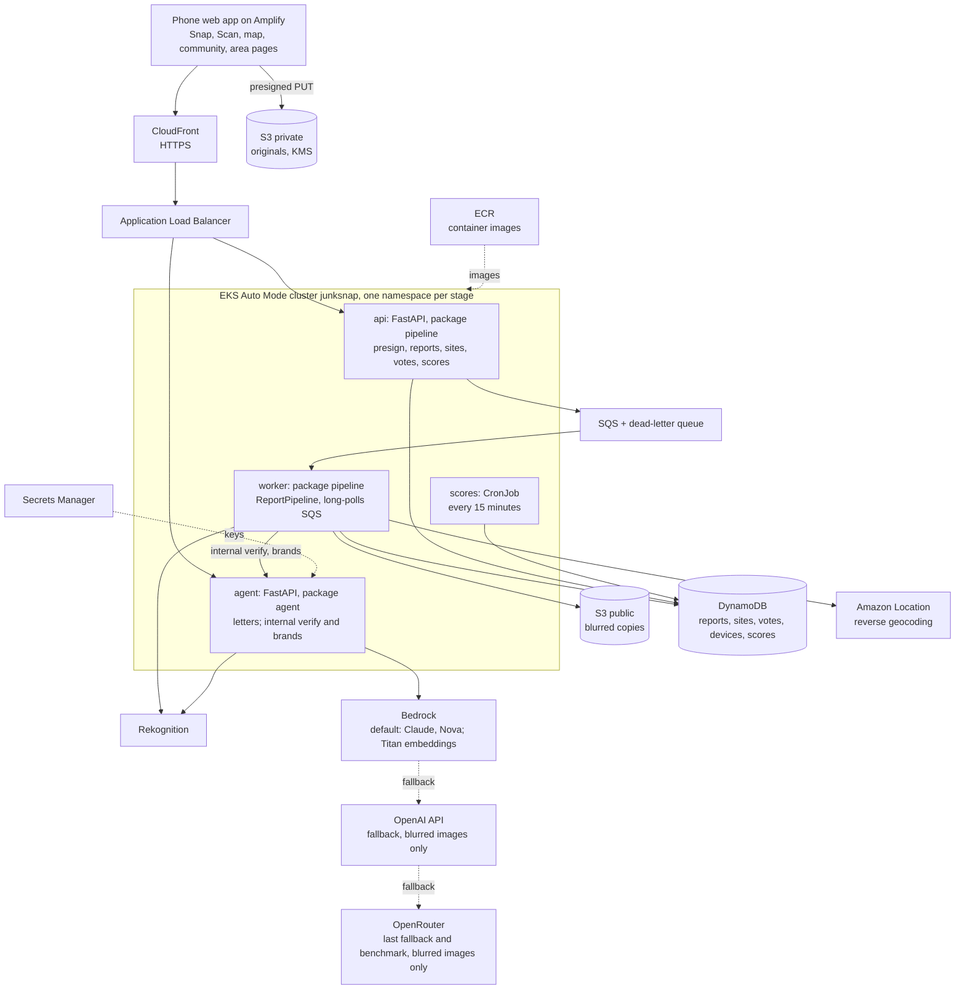
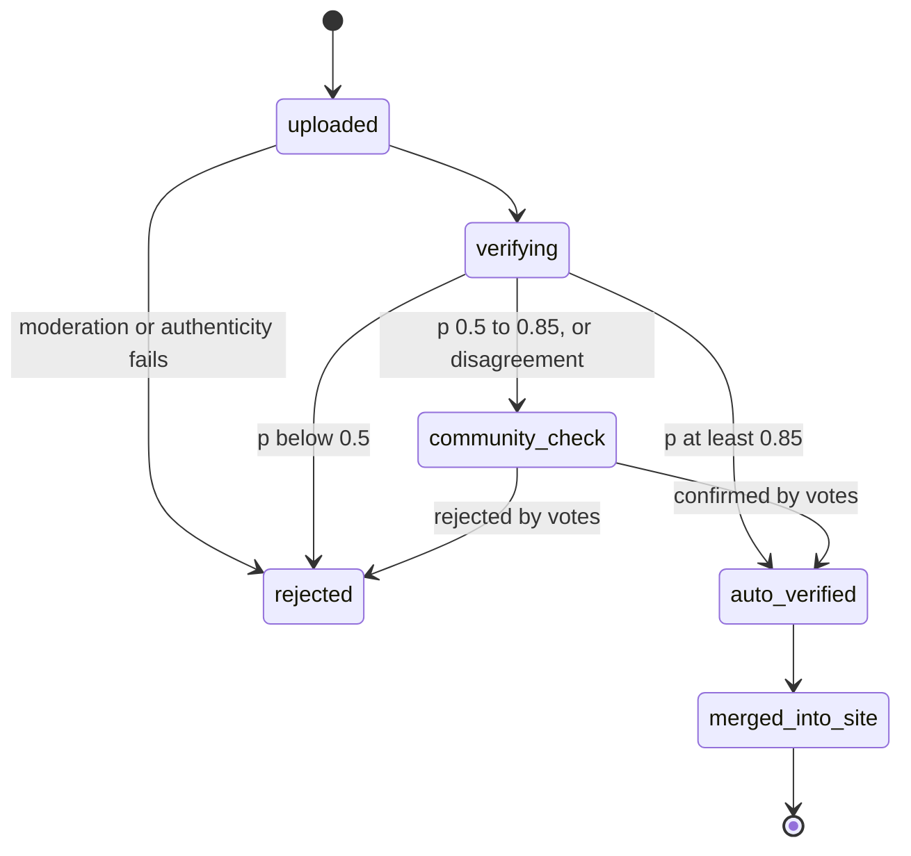

# JunkSnap architecture

JunkSnap turns a phone photo of waste into verified, located, accountable evidence. Anyone in India can report; Jodhpur is the pilot city where data goes deepest. Each report is moderated, verified by a stacked ensemble of models, merged into a site, located to its ward, assembly seat and Lok Sabha seat, scored per area, and turned into cited letters to the bodies that must act.

`contracts/` is the source of truth for every data shape and route. This document explains how the pieces fit; it never redefines a contract.

## 1. Who is involved

| Actor | Role |
|---|---|
| Reporter | Snaps a photo or runs Scan mode |
| Community verifier | Confirms or rejects uncertain reports; adds "me too" and cleanup photos |
| Moderator (team) | Settles disputes |
| Local body head | Receives letters; legally responsible for waste (74th Amendment) |
| Councillor, MLA, MP | Copied "for attention" |
| State pollution board | Receives letters on burning, contaminated water and construction dust |

## 2. System

All services run in one Amazon EKS Auto Mode cluster, `junksnap`, in ap-south-1, with one namespace per stage. CloudFront serves HTTPS in front of the Application Load Balancer. The ALB sends POST /sites/{id}/letters to `agent` and every other public route to `api`. POST /internal/verify and POST /internal/brands on `agent` are reachable only inside the cluster. Images come from ECR. Pods reach AWS through EKS Pod Identity, so no AWS keys live in pods.

## 3. Report pipeline

The `worker` long-polls the SQS reports queue. For each report or Scan frame it runs one `ReportPipeline`, which calls the steps below in order. Steps from the agent package run in the `agent` service, called over cluster-internal HTTP. A failed message is retried through SQS, then goes to the dead-letter queue with status "needs review".

| Step | Package | Runs in | Entry class | Output contract |
|---|---|---|---|---|
| 1. Moderate | pipeline | `worker` | `ModerationService` | `moderation_result` |
| 2. Authenticate | pipeline | `worker` | `AuthenticityService` | part of `moderation_result` |
| 3. Signals, in parallel threads | agent | `agent`, POST /internal/verify | `RekognitionSignal`, `YoloSignal`, `EmbeddingSignal` | signal scores |
| 4. Judge, unresolved cases only | agent | `agent`, same call | `VisionJudge` via `ProviderRouter` | judge verdict |
| 5. Decide | agent | `agent`, same call | `MetaLearner` inside `StackedVerifier` | `verification_result` |
| 6. Brands | agent | `agent`, POST /internal/brands | `BrandLabeller` | `brand_label[]` |
| 7. Locate | pipeline | `worker` | `LocationService` | `location_lookup` |
| 8. Merge | pipeline | `worker` | `SiteMerger` | `site` |
| 9. Score, every 15 minutes | pipeline | `scores` CronJob | `ScoreCalculator` | `ward_scores` |

Thresholds: probability 0.85 or more is auto-verified, 0.5 to 0.85 goes to community check, below 0.5 is rejected. Strong disagreement between signals always goes to community check. The server always re-verifies; scores from the phone are hints for live boxes and frame selection only.

## 4. Lifecycles

A site moves open → cleaned (only with an after-photo the pipeline confirms is clean) → reopened.

## 5. Edge and cloud

- Edge mode: a tiny YOLO model runs in the browser (ONNX Runtime Web) when the startup probe passes (WebGPU or WASM, under about 300 ms per frame). Confident and uncertain frames are uploaded; confident-empty frames are skipped except 1 in 20, kept for recall audits.
- Cloud mode: one downscaled frame per second is uploaded.
- An offline queue in IndexedDB retries with backoff.

## 6. Model-agnostic LLM layer

`ProviderRouter` resolves a `TaskConfig {provider, model, fallback[]}` for each task: judge, brands, letters, text moderation. Providers implement `LlmProvider`:

- `BedrockProvider`: the default. Models checked from ap-south-1 on 10 Oct at 01:15 IST; the Claude 5 family is not available for this account.
- `OpenAiProvider`: fallback after Bedrock. The key is in Secrets Manager as `junksnap/<stage>/openai-api-key`.
- `OpenRouterProvider` (OpenAI-compatible): the last fallback, and the benchmark.

Order for the judge and letters:

| Order | Provider | Model |
|---|---|---|
| 1 | Bedrock | Claude Sonnet 4.6, `global.anthropic.claude-sonnet-4-6` |
| 2 | Bedrock | Claude Haiku 4.5, `in.anthropic.claude-haiku-4-5-20251001-v1:0` (India profile) |
| 3 | Bedrock | Amazon Nova Pro, `apac.amazon.nova-pro-v1:0` |
| 4 | OpenAI API | set in `TaskConfig` |
| 5 | OpenRouter | set in `TaskConfig` |

The embedding signal uses Titan image embeddings, `amazon.titan-embed-image-v1`, on-demand in ap-south-1. Only blurred images go to any model. Every response is validated against a schema; on failure the next provider is tried. Every call logs provider, model, version, latency and estimated cost, and the evidence pack records them.

## 7. Accountability

- `LetterRouter` picks addressees from report type and state: the local body head (To); councillor, MLA and MP (Cc "for attention"); the state pollution board for burning, water and construction dust; Swachhata and CPGRAMS nationwide; Rajasthan Sampark in Rajasthan.
- `RuleRepository` serves hashed official texts. Code picks the clauses, the model writes the prose, and `QuoteVerifier` checks every quote word for word. `TemplateLetter` is the fallback.
- Quoted rule text stays in the official English or Hindi.

## 8. Area scores

City, citizen and bin-access scores are computed per ward, assembly seat, Lok Sabha seat and district. Formulas are versioned in `docs/decisions/`. Guardrails: area level only, at least 10 verified reports before a score shows, counts always shown, a pilot flag, no invented history.

## 9. Security and privacy

- Originals sit in a private bucket under KMS and are never public. Public copies have faces and number plates blurred.
- No photos of people dumping, and no names of individuals in any text.
- Only blurred images go to any model on Bedrock, OpenAI or OpenRouter.
- Per-device tokens, rate limits, perceptual-hash duplicate checks, an India geofence and fresh timestamps.
- Secrets live in Secrets Manager; nothing secret in the repo.

## 10. Stages and deployment

Two stages: `dev` for building and `demo` for the recording, deployed only from a clean `main` when the human says so.

- Cluster: one EKS Auto Mode cluster `junksnap` in ap-south-1, from eksctl `infra/eks/cluster.yaml`. Each stage is a namespace: `junksnap-dev` and `junksnap-demo`.
- Per-stage AWS resources (buckets, tables, queues, Pod Identity roles, place index, secrets) come from CloudFormation `infra/aws/stage.yaml`, stacks `junksnap-<stage>`.
- Manifests use Kustomize: `infra/k8s/base`, `infra/k8s/overlays/dev`, `infra/k8s/overlays/demo`. Images live in ECR.
- Amplify builds the frontend from `main`.
- The cluster costs about $7/day from credits while it runs. Tear it down after judging.

## 11. Failure modes

| Failure | Fallback |
|---|---|
| Model provider throttled or unavailable | Next provider in `TaskConfig.fallback` |
| Phone cannot run the model | Cloud mode |
| No network | Offline queue |
| Letter verification fails | Template letter with the same citations |
| Pipeline step error, or `agent` unreachable from `worker` | SQS retry, then dead-letter queue and a "needs review" status |
| Pod crashes or node is replaced | Kubernetes restarts the pod; an unfinished SQS message becomes visible again and is retried |
| `scores` run fails | The next run, 15 minutes later, recomputes from DynamoDB |

## 12. Roadmap (not built)

Drones and CCTV through Kinesis Video Streams, satellite history beyond large sites, packaging-type EPR analytics per area, MLA lists for more states, potholes.
