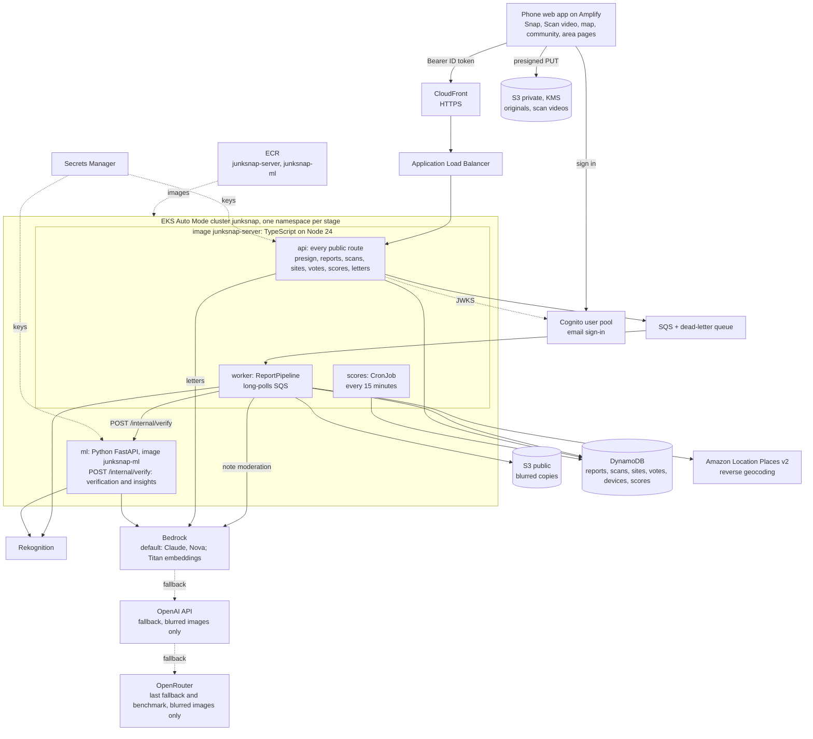
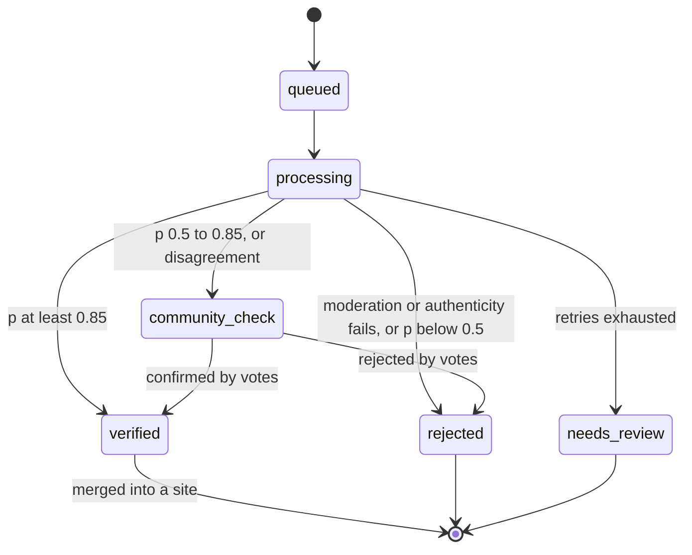

# JunkSnap architecture

JunkSnap turns a phone photo or a short Scan video of waste into verified, located, accountable evidence. Anyone in India can report; Jodhpur is the pilot city where data goes deepest. Each report is moderated, verified by a stacked ensemble of models, described (what the waste is, how big, which hazards, what is nearby), merged into a site, located to its ward (where an open ward map exists), assembly seat (Rajasthan for now) and Lok Sabha seat, scored per area, and turned into cited letters to the bodies that must act.

`contracts/` is the source of truth for every data shape and route. This document explains how the pieces fit; it never redefines a contract.

## 1. Who is involved

| Actor | Role |
|---|---|
| Reporter | Snaps a photo or records a Scan video |
| Community verifier | Confirms or rejects uncertain reports; adds "me too" and cleanup photos |
| Moderator (team) | Settles disputes |
| Local body head | Receives letters; legally responsible for waste (74th Amendment) |
| Councillor, MLA, MP | Copied "for attention" |
| State pollution board | Receives letters on burning, contaminated water and construction dust |

## 2. System

All services run in one Amazon EKS Auto Mode cluster, `junksnap`, in ap-south-1, with one namespace per stage (decision 20261010-0130). The code is split by language (decision 20261010-0159):

- `backend/server/`: one TypeScript project (TypeScript 6.0.3, Node 24), built into one image, `junksnap-server`, that runs three workloads from three entry files. `api` (`web.ts`) serves every public route, letters included. `worker` (`worker.ts`) runs the report pipeline from SQS. `scores` (`scores.ts`) is the CronJob. They share domain classes and the contract types generated from `contracts/schemas`.
- `backend/ml/`: the Python service `ml`, image `junksnap-ml`. Its only route besides `/healthz` is the cluster-internal `POST /internal/verify`: stacked verification and insights. Training and dataset tooling sit in `backend/ml/training/`. Python stays only where the ML libraries are.
- Data tooling (the ward crawler, rule checks) may stay Python. `backend/pipeline` is retired and is deleted once the TS server lands; `backend/agent` is being renamed to `backend/ml`.

CloudFront serves HTTPS in front of the Application Load Balancer, which sends every public route to `api`. Nothing public reaches `ml`. Pods reach AWS through EKS Pod Identity, so no AWS keys live in pods.

Accounts (decision 20261010-0227): one Amazon Cognito user pool per stage, email and password with an emailed code. Browsing is open. Creating reports, scans, votes, cleanups and letters needs the Cognito ID token as `Authorization: Bearer`; the `api` checks it against the pool's JWKS and takes `user_id` from its `sub`. The `device_token` stays, so reputation and rate limits count per user and per device. No user's name or email is stored outside Cognito.

## 3. Report pipeline

The `worker` long-polls the SQS reports queue. A message is a report, a cleanup or a scan. For each report it runs one `ReportPipeline`, which calls the steps below in order. Verification runs in `ml`, called over cluster-internal HTTP at `ML_URL` (`contracts/README.md`). The worker sends `ml` only the blurred copy's key (`media/reports/{report_id}.jpg`), never the original, and `ml`'s Pod Identity role cannot read the originals bucket; it may only write `embeddings/`.

Every step is idempotent per report id: moderation and verification results are written keyed by report id, and site merge records which report ids it has merged and skips repeats, so retries cannot inflate counts. A failed message is retried through SQS. When its `ApproximateReceiveCount` reaches the max receive count, the worker marks the report `needs_review` before the message moves to the dead-letter queue, so the phone never waits forever.

| Step | Runs in | Language | Entry class | Output contract |
|---|---|---|---|---|
| 1. Moderate and blur | `worker` | TypeScript | `ModerationService` | `moderation_result` |
| 2. Authenticate | `worker` | TypeScript | `AuthenticityService` | part of `moderation_result` |
| 3. Signals, in parallel | `ml`, POST /internal/verify | Python | `RekognitionSignal`, `YoloSignal`, `EmbeddingSignal` (with the type classifier) | signal scores |
| 4. Judge, unresolved cases only | `ml`, same call | Python | `VisionJudge` via `ProviderRouter` | judge verdict |
| 5. Decide and describe | `ml`, same call | Python | `MetaLearner` inside `StackedVerifier`; `InsightExtractor` | `verification_result` with `insights` |
| 6. Brands | `worker` | TypeScript | `BrandLabeller` (Rekognition DetectText and the brand map) | `brand_label[]` |
| 7. Locate, find nearby places | `worker` | TypeScript | `LocationService` (Places v2, boundaries), `NearbyPlaceFinder` (crawler map layers) | `location_lookup`, `site.insights.near` |
| 8. Merge | `worker` | TypeScript | `SiteMerger`, `InsightMerger` | `site` with `insights` |
| 9. Score, every 15 minutes | `scores` CronJob | TypeScript | `ScoreCalculator`, `AreaInsightCalculator` | `ward_scores` with `insights` |

Step 1 also moderates the free-text note. It runs on Bedrock, Claude Haiku 4.5 India profile, through the TypeScript LLM layer, and on Bedrock only because the note is personal text. Amazon Comprehend is not enabled on this account, so nothing calls it.

The LLM is the last step in detection. Rekognition labels, YOLO and Titan embeddings decide first; the vision judge runs only when they are not confident or disagree, and it never sets counts or boxes.

Thresholds: probability 0.85 or more is auto-verified, 0.5 to 0.85 goes to community check, below 0.5 is rejected. Strong disagreement between signals always goes to community check. The server always re-verifies; scores from the phone are hints for live boxes and frame selection only.

**Scan sessions** (decision 20261010-0203). A `kind: scan` message names a scan. `ScanFrameSampler` reads the video from the private bucket and cuts one frame per second; a phone-hinted frame replaces the plain one in its second. `TrackInterpolator` maps each frame's time onto the GPS track and drops frames whose nearest fix is more than 3 s away or worse than 50 m. Each kept frame becomes a `capture_mode: scan` report with an id derived from the scan id and frame time, plus its own `kind: report` message, so it runs every step above, moderation and blur included. The video stays private and never goes to a model.

## 4. Lifecycles

State names are the `status` values of GET /reports/{id} in `contracts/README.md`. A verified report is merged into a site, which sets its `site_id`.

A site moves open → cleaned (only with an after-photo the pipeline confirms is clean) → reopened. A scan moves queued → processing → done, or failed (`invalid_video` or `retries_exhausted`).

## 5. Capture: Snap and Scan

- Snap and Scan need a signed-in user; the map, sites and area pages do not.
- Snap: one photo from the in-app camera, hashed on the phone, PUT by presigned URL, then `POST /reports`.
- Scan: the app records video (at most 60 s, 720p, 40 MB) and a GPS track from `watchPosition`, at least one fix per second, both timed from the start of recording. After stop it PUTs the video and posts the `scan_session`.
- Edge mode: a tiny YOLO model runs in the browser (ONNX Runtime Web) when the startup probe passes (WebGPU or WASM, under about 300 ms per frame). It draws live boxes and adds its detections to the scan session as hints for frame choice. Without it (cloud mode) the scan goes up without hints.
- An offline queue in IndexedDB retries photos and videos with backoff.

## 6. Insights

The models report what the waste is, not only whether it exists (decision 20261010-0202). Only measured numbers, and every insight says where it came from.

| Level | Contract field | What | Where it came from |
|---|---|---|---|
| Report | `verification_result.insights` | composition shares by material (plastic, organic, construction debris, paper, glass, metal, textile, e-waste, medical); size class small, medium or large, never tonnage; hazards (burning or smoke, medical waste, e-waste, dead animal, chemicals) | the model behind each estimate: signal, provider, model, version |
| Site | `site.insights` | the report insights merged over the site's verified reports only (the same reports `site.burning` comes from); sensitive places within 100 m (school, hospital, water body, open drain) | report counts and models; the OpenStreetMap layer and fetch for each place |
| Area | `ward_scores.insights` | composition shares, share of hazardous sites, top brands by count (readable labels only), repeat spots, reports by hour and weekday, sites near schools or water | the counts behind each value |

- Composition, size and hazards come from YOLO's material classes and the embedding classifier first, Rekognition labels (Fire, Smoke) for burning. The judge only fills a gap the other models leave, and is then named as the source.
- Nearby places: during the location step the worker measures the distance from the site to the `school`, `hospital`, `water` and `drain` features in the crawler's city-wide OpenStreetMap layers (`map_layers` in `data/wards/<city>.json`), so it works where the site has no ward.
- Area insights: the `scores` CronJob counts verified reports and their sites in the data window. Shares and patterns follow the 10-verified-report guardrail; plain counts always show.
- Insight models, like the verifier, are trained and evaluated on openly licensed public data only, on its fixed test split (decision 20261010-1245; `docs/ml/eval.md`). Field photos are not used for training or a holdout.

## 7. Model-agnostic LLM layer

The main LLM use is the ward-data crawler (below); in detection the LLM comes last (section 3).

There are two implementations with the same `TaskConfig {provider, model, fallback[]}` shape and the same provider order. The TypeScript one in `backend/server` serves letters (`api`) and note moderation (`worker`, Bedrock only). The Python one in `backend/ml` serves the vision judge. Providers implement `LlmProvider`:

- `BedrockProvider`: the default. Models checked from ap-south-1 on 10 Oct at 01:15 IST; the Claude 5 family is not available for this account.
- `OpenAiProvider`: fallback after Bedrock. The key is in Secrets Manager as `junksnap/<stage>/openai-api-key`.
- `OpenRouterProvider` (OpenAI-compatible): the last fallback, and the benchmark.

Order for the judge and letters:

| Order | Provider | Model |
|---|---|---|
| 1 | Bedrock | Claude Sonnet 4.6, `global.anthropic.claude-sonnet-4-6` |
| 2 | Bedrock | Claude Haiku 4.5, `in.anthropic.claude-haiku-4-5-20251001-v1:0` (India profile) |
| 3 | Bedrock | Amazon Nova Pro, `apac.amazon.nova-pro-v1:0` |
| 4 | OpenAI API | set in `TaskConfig` |
| 5 | OpenRouter | set in `TaskConfig` |

Note moderation uses Claude Haiku 4.5 (India profile) on Bedrock. The embedding signal uses Titan image embeddings, `amazon.titan-embed-image-v1`, on-demand in ap-south-1. Only blurred images go to any model. Every response is validated against a schema; on failure the next provider is tried. Every call logs provider, model, version, latency and estimated cost, and the evidence pack records them.

Ward-data crawler: an offline Python job, not part of the report pipeline. It reads official public pages (municipal corporation and ward lists, census tables, state election and assembly sites, Lok Sabha, Swachh Survekshan) and OpenStreetMap (disposal points, schools, hospitals, water bodies, open drains). It writes `data/wards/<city>.json`: one `ward_record` per ward (ward number and name, municipal body, zone, area km², population, councillor seat, sanitation office contact, legal disposal and collection points, assembly and Lok Sabha seat) and city-wide OpenStreetMap map layers (disposal, school, hospital, water, drain). Each value carries its source URL, `fetched_at` and the page's SHA-256. Records are validated against the contract and reviewed by a person before use. It stores offices and seats only, never personal names. Location, nearby places and area scores read this file.

## 8. Accountability

Letters are built in the `api` (TypeScript).

- `LetterRouter` picks addressees from report type and state: the local body head (To); councillor, MLA and MP (Cc "for attention"), each only when `site.location` has that seat: no councillor without a ward map, no MLA outside Rajasthan (assembly boundaries are loaded only there), no MP for a Lok Sabha seat marked `outdated` (Assam, Jammu and Kashmir, Ladakh until re-delimited boundaries are added); the state pollution board for burning, water and construction dust; Swachhata and CPGRAMS nationwide; Rajasthan Sampark in Rajasthan.
- `RuleRepository` serves hashed official texts. Code picks the clauses, the model writes the prose, and `QuoteVerifier` checks every quote word for word. `TemplateLetter` is the fallback.
- Quoted rule text stays in the official English or Hindi.

## 9. Area scores

City, citizen and bin-access scores are computed per ward, assembly seat, Lok Sabha seat and district. Ward area, population and legal disposal points come from the crawled ward records in `data/wards/`. Formulas are versioned in `docs/decisions/`. Guardrails: area level only, at least 10 verified reports before a score shows, counts always shown, a pilot flag, no invented history. The same CronJob writes the area insights (section 6).

## 10. Security and privacy

- Originals and scan videos sit in a private bucket under KMS and are never public. Public copies have faces and number plates blurred; every scan frame is blurred like a photo.
- No photos of people dumping, and no names of individuals in any text.
- Only blurred images go to any model on Bedrock, OpenAI or OpenRouter. A scan video never goes to a model. Personal text (the note) goes to Bedrock only.
- `ml` reads only `media/` in the public bucket and writes only `embeddings/` in the private one.
- Training and evaluation run offline on openly licensed public datasets only (decision 20261010-1245); field-audit photos are never copied into `datasets/`. No pod can read `datasets/`.
- Accounts live in Cognito. Tables and logs hold only the opaque `user_id`, never a user's name or email; tokens are never logged.
- Per-device tokens, rate limits, perceptual-hash duplicate checks, an India geofence and fresh timestamps.
- Secrets live in Secrets Manager; nothing secret in the repo.

## 11. Stages and deployment

Two stages: `dev` for building and `demo` for the recording, deployed only from a clean `main` when the human says so.

- Cluster: one EKS Auto Mode cluster `junksnap` in ap-south-1, from eksctl `infra/eks/cluster.yaml`. Each stage is a namespace: `junksnap-dev` and `junksnap-demo`.
- Workloads: Deployments `api`, `worker` and `ml`, and the CronJob `scores`. Images in ECR: `junksnap-server` (api, worker, scores) and `junksnap-ml`.
- Per-stage AWS resources (buckets, tables, queues, Pod Identity roles, the Cognito user pool and app client, secrets) come from CloudFormation `infra/aws/stage.yaml`, stacks `junksnap-<stage>`. Places v2 needs no place index; the worker role gets `geo-places:ReverseGeocode`.
- Manifests use Kustomize: `infra/k8s/base`, `infra/k8s/overlays/dev`, `infra/k8s/overlays/demo`.
- Amplify builds the frontend from `main`.
- The cluster costs about $7/day from credits while it runs. Tear it down after judging.

## 12. Failure modes

| Failure | Fallback |
|---|---|
| Model provider throttled or unavailable | Next provider in `TaskConfig.fallback` |
| Phone cannot run the model | Cloud mode: the scan goes up without hints |
| No network | Offline queue |
| Letter verification fails | Template letter with the same citations |
| Pipeline step error, or `ml` unreachable from `worker` | SQS retry. On the last allowed receive the worker marks the report `needs_review`, then the message moves to the dead-letter queue |
| Scan video too long, too large or unreadable | Scan `failed` with `invalid_video`; the phone shows why |
| GPS gaps during a scan | Frames without a close, accurate fix are dropped and counted in `frames.dropped_no_fix` |
| Same message processed twice | Steps are idempotent per report id; scan frame ids are derived from the scan id and frame time; site merge skips report ids it has already merged |
| Pod crashes or node is replaced | Kubernetes restarts the pod; an unfinished SQS message becomes visible again and is retried |
| `scores` run fails | The next run, 15 minutes later, recomputes from DynamoDB |

## 13. Roadmap (not built)

Drones and CCTV through Kinesis Video Streams, satellite history beyond large sites, EPR analytics beyond top brands per area, MLA lists for more states, potholes.
